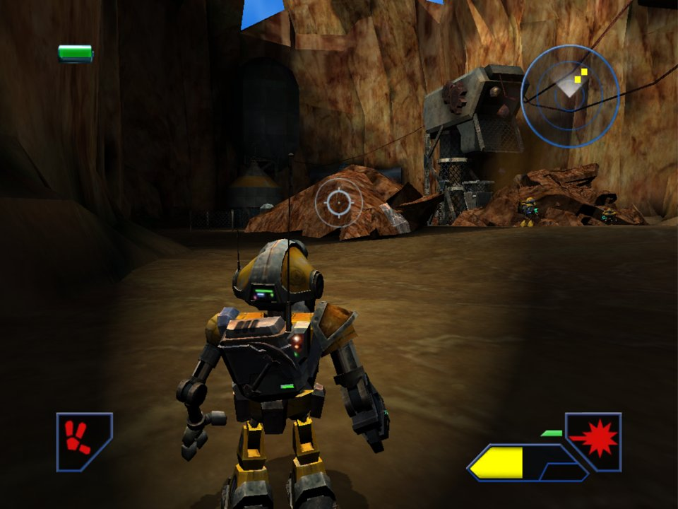
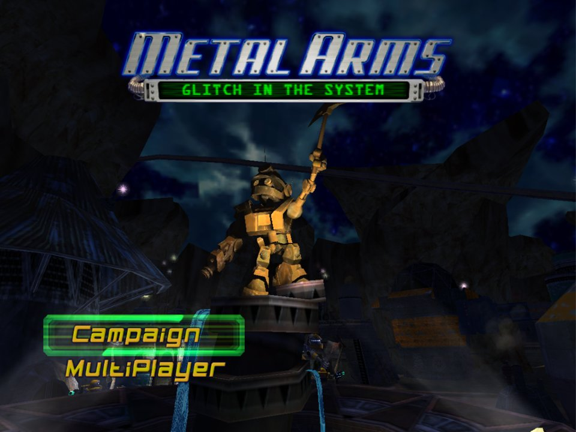
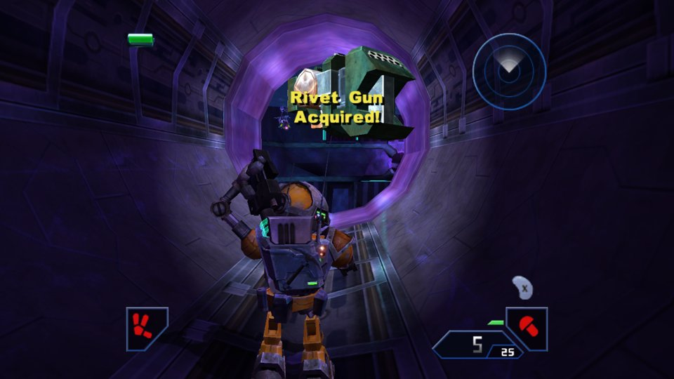

# Metal Arms: Recompiled

**Metal Arms: Glitch in the System** running natively on Windows, built by statically recompiling the original GameCube executable to C. No emulator: the game's own code runs as a native PC program, with a modern renderer, mouse and keyboard controls, widescreen and higher resolutions.

[Português](README.pt-BR.md)

<p align="center">
  
  
</p>

> [!IMPORTANT]
> **You need your own copy of the game.** This project does not include any game code, data, music or video. On first launch you point it to a disc image of **Metal Arms: Glitch in the System** for the **GameCube (USA, GM5E7D)**, dumped from a disc you own.

## Features

- Native Windows executable: all 42 campaign missions and 14 multiplayer arenas load and run (checked by an automated test; a full playthrough is still in progress)
- Direct3D 11 renderer with internal resolution up to 4× (1280×1056 by default), anisotropic filtering and v-sync
- Optional 16:9 widescreen with a wider field of view (the HUD stays in the 4:3 area)
- Mouse aiming built for PC: the same turn per mouse movement on both axes, at any speed
- Fully remappable keyboard and mouse controls
- Up to 4 XInput controllers (Xbox and compatible) for local split-screen, with rumble
- Original audio through an emulated GameCube DSP running the game's MusyX sound driver
- Memory card saves stored as `.gci` files, compatible with Dolphin
- Steady 60 FPS, with the renderer running on its own thread

<p align="center">
  
</p>

## Requirements

- Windows 10 or 11 (64-bit) and a GPU with Direct3D 11 support
- A disc image of **Metal Arms: Glitch in the System (USA)**, GameCube, game ID **GM5E7D**, in one of these formats:
  - `.iso` / `.gcm` (raw disc image)
  - `.ciso` (compact ISO)

  RVZ, GCZ and WIA images are not read directly yet. Convert them to ISO in Dolphin: right-click the game → **Convert File...** → **ISO**.

Other regions (Europe, Japan) and the PlayStation 2 / Xbox versions are not supported.

## Installation

### Quiver Launcher

Add **Metal Arms: Recompiled** from the catalog and press Play. On first launch, choose your disc image (see below).

### Manual

1. Download the latest `MetalArmsRecompiled-<version>-windows-x64.zip` from the [Releases](https://github.com/matheussvml/Metal-Arms-Recompiled/releases) page.
2. Extract it to any folder.
3. Run `metalarms.exe`.

### First launch

The game looks for your disc image next to `metalarms.exe` (and in its subfolders). If it doesn't find one, a window opens so you can pick the file. The path is remembered in `metalarms.ini`, so this happens only once.

## Controls

| Action | Controller | Keyboard and mouse |
|---|---|---|
| Move | Left stick | W A S D |
| Aim / camera | Right stick | Mouse (or I J K L) |
| Jump / confirm (A) | A | Space |
| Back (B) | B | Tab |
| X / Y | X / Y | F / V |
| Melee (Z) | RB | Right mouse button |
| L | LT | Z |
| Fire (R) | RT | Left mouse button (or E) |
| Pause (Start) | Start | Esc (or Enter) |
| D-pad | D-pad | Arrow keys |

- Click inside the window to capture the mouse. The key below Esc (`` ` `` on US keyboards, `'` on Brazilian ABNT2) shows or hides the cursor, and switching windows releases it.
- **F11** toggles borderless fullscreen. The window can be resized freely.
- Every key can be changed in the `[teclado]` section of `metalarms.ini`.

## Settings

`metalarms.ini` is created next to the executable on first launch. The keys are in Portuguese, the language of the original author:

| Key | Default | Meaning |
|---|---|---|
| `escala` | `2` | Internal resolution multiplier, 1 to 4 |
| `tela_cheia` | `0` | `1` = start in borderless fullscreen |
| `widescreen` | `0` | `1` = 16:9 with a wider field of view |
| `vsync` | `1` | `0` = don't wait for the monitor (may tear) |
| `anisotropia` | `8` | Anisotropic filtering, `0` (like the GameCube) to `16` |
| `mouse` | `1` | `0` = disable mouse aiming |
| `mouse_sensibilidade` | `4` | Mouse sensitivity (4 ≈ 0.14° per mouse unit) |
| `mouse_sensibilidade_vertical` | `1` | Extra multiplier for vertical aiming only |
| `mouse_inverter_y` | `0` | `1` = invert vertical aiming |
| `teclado_separado` | `0` | `1` = keyboard and mouse are player 1 alone; controllers become players 2–4 |
| `pular_videos` | `0` | `1` = skip all videos |
| `disco` | | Path to the disc image (filled in automatically) |
| `saves` | `saves/slotA` | Memory card folder |
| `tecla_<button>` | | Keyboard bindings, e.g. `tecla_a=ESPACO`, `tecla_r=MOUSE_ESQ,E` (several keys separated by commas) |

## Saves

Saves are stored in `saves/slotA` as `.gci` files, the same format Dolphin uses for GCI folder memory cards. You can copy saves between the two in both directions:

- **From Dolphin:** set Memory Card Slot A to **GCI Folder** and copy the files from `Dolphin Emulator/GC/USA/Card A/` to `saves/slotA`.
- **To Dolphin:** copy the files the other way.

## Known issues

- Windows only. The renderer uses Direct3D 11.
- Mouse turning is capped by the game's own maximum turn speed (~300°/s). Very fast flicks turn as far as the game allows and then stop.
- Disc images must be ISO, GCM or CISO (see Requirements).
- Local multiplayer with more than one controller has not been tested with real hardware yet.
- The game has not been played from start to finish on this port yet. Each mission was checked to load and run, but problems may show up later in a mission.

Found a problem? [Open an issue](https://github.com/matheussvml/Metal-Arms-Recompiled/issues) with the end of `metalarms.log` (next to the executable) and, if it's visual, a screenshot.

## Building from source

Requirements: Visual Studio Build Tools (MSVC x64), Python 3 and Git Bash. The game's executable (`main.dol`) comes from your own disc and is never committed:

```bash
python tools/gc_extract.py "<your disc .iso/.ciso>" extracted
mkdir -p orig/GM5E7D/sys && cp extracted/main.dol orig/GM5E7D/sys/
bash tools/build/build_game.sh   # -> build/metalarms.exe
bash tools/build/package.sh      # -> dist/MetalArmsRecompiled-<version>-windows-x64.zip
```

The technical documentation (in Portuguese) is in [docs/](docs/desenvolvimento.md): the recompiler, the renderer, audio, memory card, performance and the developer options.

## How it works

`recomp/gen.py` translates every PowerPC function of the game's executable into C. Function boundaries come from an analysis made with decomp-toolkit, plus Dolphin's SDK signatures and manually identified functions. The resulting C code is compiled together with a runtime that replaces the GameCube hardware:

- **CPU and OS:** the game's threads run as Windows fibers. Disc access, memory card and controllers are reimplemented natively (HLE).
- **Graphics:** the GX command stream is interpreted on its own thread and drawn with Direct3D 11. The TEV pipeline is translated into generated pixel shaders, and textures are decoded from every GameCube format.
- **Audio:** the GameCube DSP is emulated with the game's original MusyX microcode.
- **Timing:** video interrupts, audio DMA and the rest of the hardware timing follow the console.

## Credits

- **Dolphin Emulator** team: the GameCube hardware documentation this port relies on, the free DSP ROM shipped in `data/dsp` (GPLv2) and the SDK signature database used to name functions.
- **decomp-toolkit** by encounter: analysis of the executable.
- The **N64: Recompiled** and **Nebula** projects, which inspired the approach.
- **Swingin' Ape Studios** and **Vivendi Universal Games**, creators and publisher of Metal Arms: Glitch in the System.

## License

The code in this repository is licensed under the [GNU General Public License v3.0](LICENSE). The free DSP ROM in `data/dsp` and the SDK signature database in `tools/sigs` come from the Dolphin Emulator project (GPL-2.0-or-later). The license does not cover the game itself: its code, data, names and trademarks belong to their owners.

## Legal

This is an unofficial fan project. It is not affiliated with, endorsed or sponsored by Swingin' Ape Studios, Vivendi, Activision Blizzard or Nintendo. Metal Arms: Glitch in the System and all related names and assets belong to their respective owners. This repository and its releases contain no game data: you must supply a disc image dumped from a copy you legally own. The program icon (`assets/`) and the screenshots in `docs/images` show the game's own artwork, which belongs to its owners.
